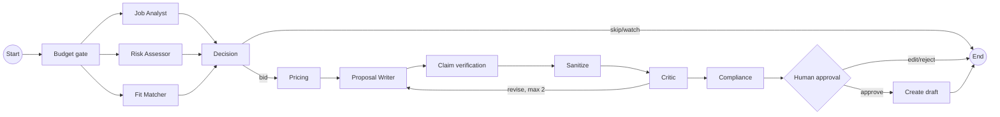
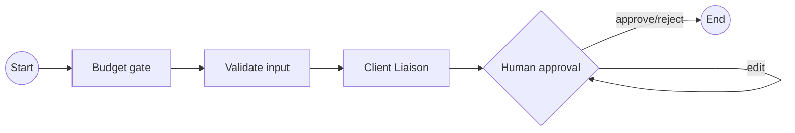

# GigBid graph evidence

The assignment has two durable LangGraph workflows. They share typed state and approval
semantics, but have different responsibilities.

## Bid graph

## Conversation graph

The UI streams both graphs through the same SSE update/complete/trace contract. A conversation
approval is checkpointed by thread ID and can be restored after refresh; approving a conversation
is still a local review in this prototype and never sends a message.
